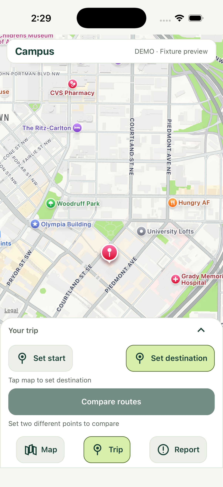
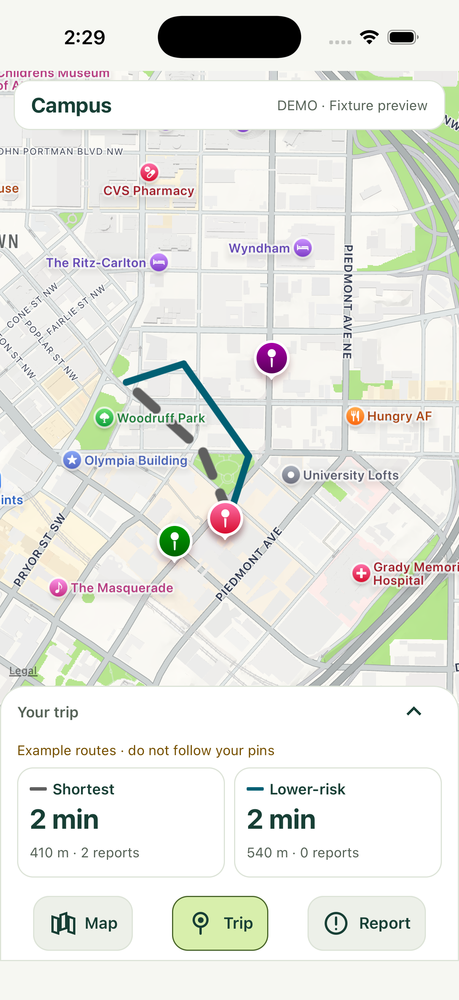

# UI concept screenshots

Captured 2026-10-10 from the actual React Native app on iPhone 17 Pro / iOS 26.1 Simulator,
Expo Go 57.0.9, SDK 57. The images show the map-first revision on `lane/a-ui`.
They are unedited simulator captures, in offline fixture mode. The existing Apple map remains
until the separate OSM migration lands; the route lines are explicitly illustrative.

| Map home | Trip setup |
| --- | --- |
|  |  |

| Route comparison | Report categories |
| --- | --- |
|  |  |

Checked by interaction: destination/start placement, comparison, task switching with trip
preserved, expanded/collapsed details, clearing endpoints, and disabled reporting in demo mode.
The screenshot session is not physical-device, Android, live-backend or complete accessibility
validation. See the [mobile UI guide](../UI-GUIDE.md) for remaining checks.
