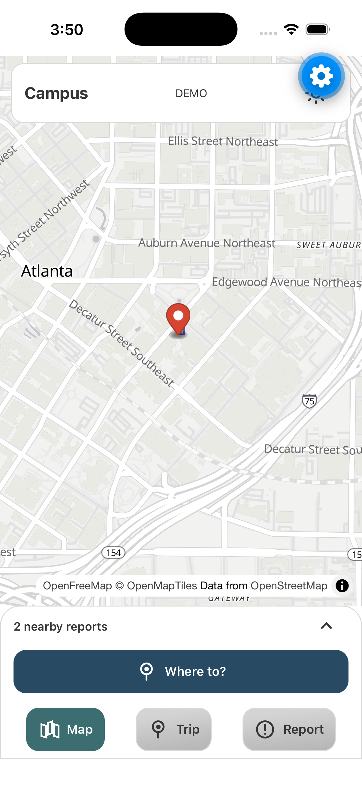
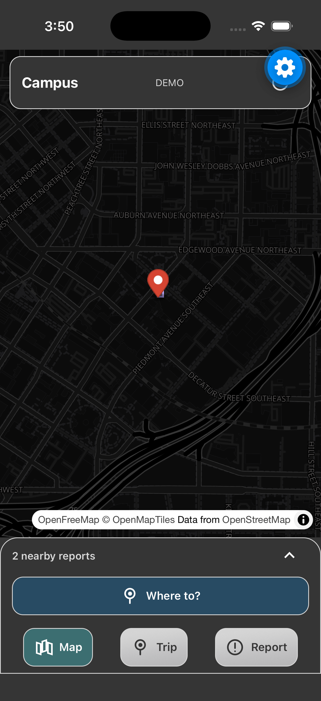
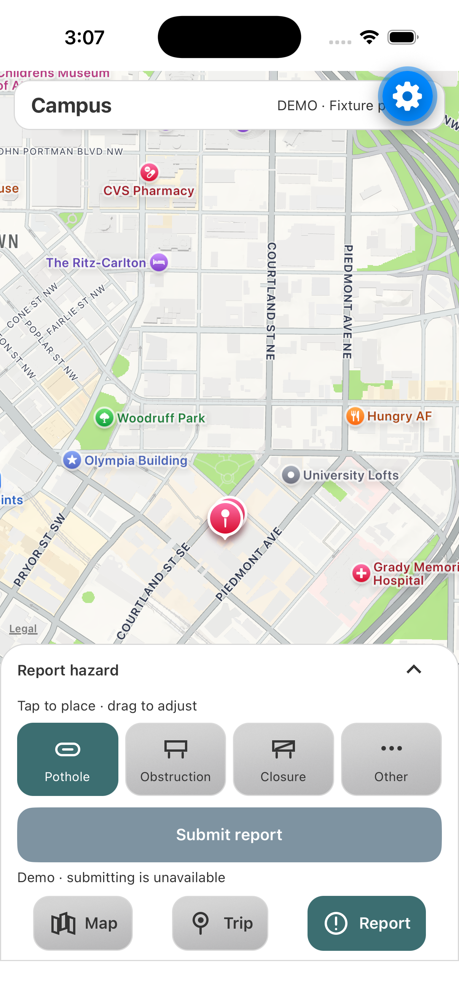
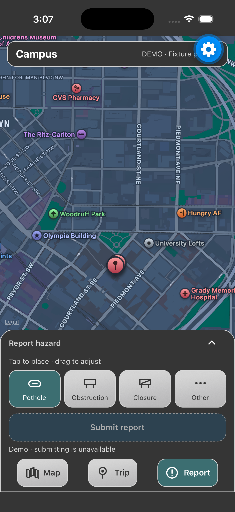
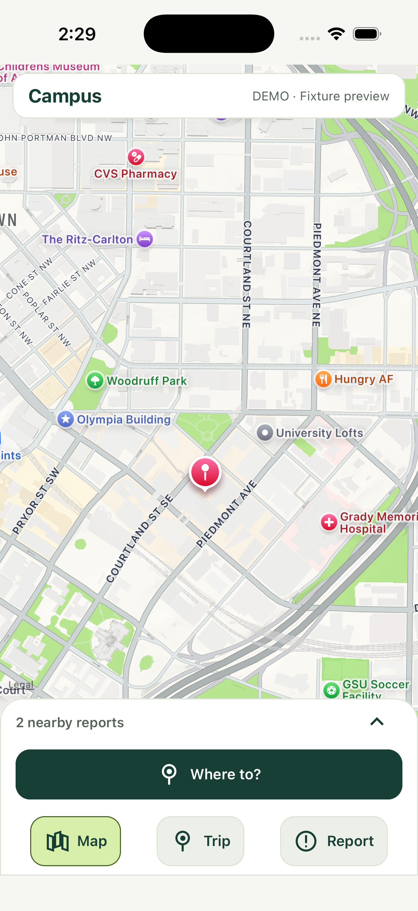
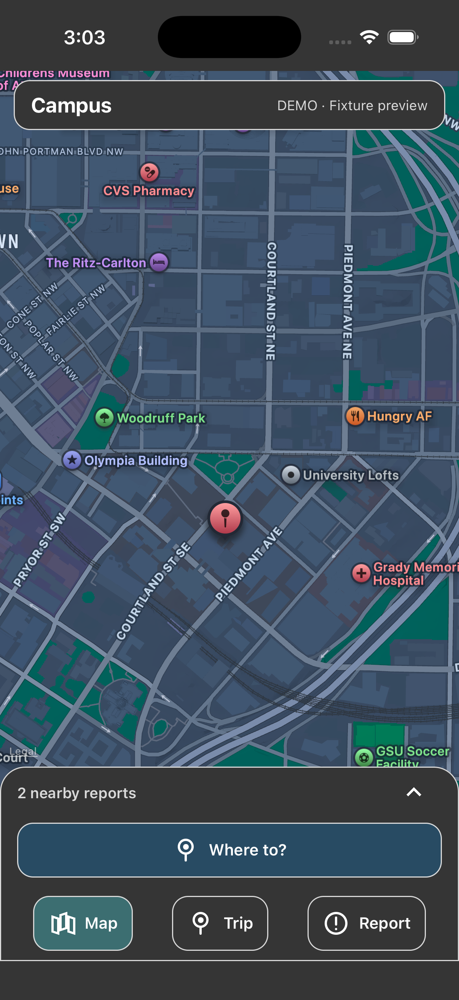
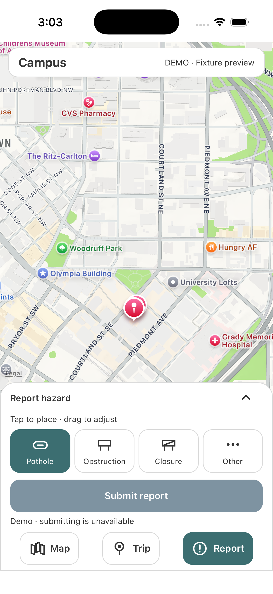
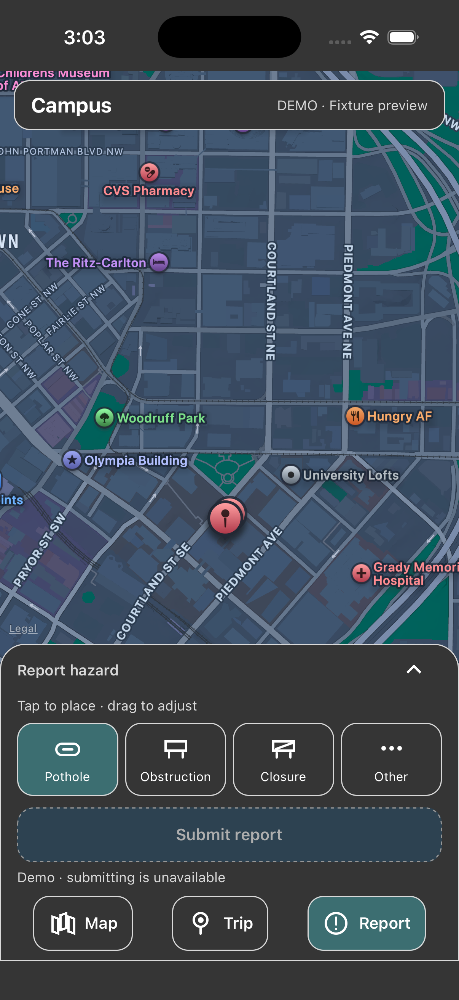

# UI concept screenshots

Current OSM layout with unified appearance switch (verified both directions on iPhone 17):

| Light UI and Positron | Dark UI and Dark Matter |
| --- | --- |
|  |  |

The blue gear is Expo development chrome; the app appearance switch sits beneath it in these captures.

Latest metallic texture revision (iPhone 17, same fixture setup):

| Light metallic controls | Dark metallic controls |
| --- | --- |
|  |  |

The blue gear in these two captures is the Expo development overlay, not an app control.
The earlier gallery below predates the textured silver controls.

Captured 2026-10-10 from the actual React Native app on iPhone 17 / iOS 26.1 Simulator,
Expo Go 57.0.9, SDK 57. These unedited captures show the silver/cyan palette in offline fixture mode.
The existing Apple map remains until the separate OSM migration lands.

| Light Map | Dark Map |
| --- | --- |
|  |  |

| Light Report | Dark Report |
| --- | --- |
|  |  |

`ui-plan-trip.png` and `ui-comparison.png` retain the previous iPhone 17 Pro concept captures;
their green controls predate the current palette and are retained only as interaction references.
Route lines in those fixture screenshots are illustrative.

Checked by interaction in the concept: destination/start placement, comparison, task switching
with trip preserved, expanded/collapsed details, clearing endpoints, and disabled reporting in demo mode.
The palette pass checked light/dark Map and Report surfaces. Updated route colors typecheck but
still need a refreshed route screenshot. This is not physical-device, Android, live-backend or
complete accessibility validation. See the [mobile UI guide](../UI-GUIDE.md) for remaining checks.
